# Badini Writing Assistant

**Everyday writing in Badini Kurdish, made simple.**

Badini (Behdini) is a Kurmanji variety spoken in Duhok and the Badinan region, written in
Arabic script, and it has almost no everyday writing tools. This app is built for the
writing people actually do in study and work: fix a text, translate, write a letter or an
application, and hand it in as Word or PDF.

> **Status: early preview, in active development.** This repository only shows the
> product. The source code is private for now. Some features need a language model that
> is still being tested, and they are not shown in the screenshots below.

## What it does

- **Write** in one clean editor. Unknown words are underlined and one tap fixes them.
  Missing diacritics can be restored, and every change is a suggestion you accept or
  dismiss.
- **Documents**: leave request, complaint, job or study application, declaration and power
  of attorney, filled in from a short form.
- **Export** any result as **Word (.docx)** or **PDF**, right to left with proper Arabic
  script shaping.
- **Convert** between Arabic and Latin (Hawar) script, and add diacritics.
- **Summarize** a long text by picking out its key sentences. Nothing is made up.
- **Verb forms**: look up how an English verb conjugates in Badini.
- Works on **phones, tablets and the web** from one app, in **English or Kurdish**, with
  light and dark themes.

## Screenshots

### Phone

| Home | Spelling, tap to fix | Diacritics |
|---|---|---|
| 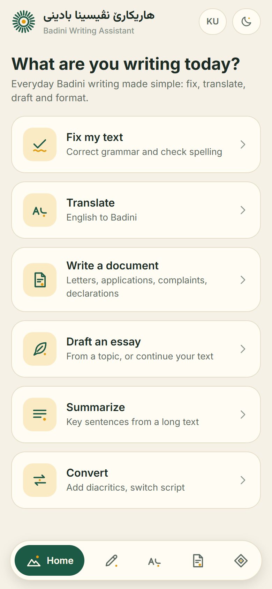 | 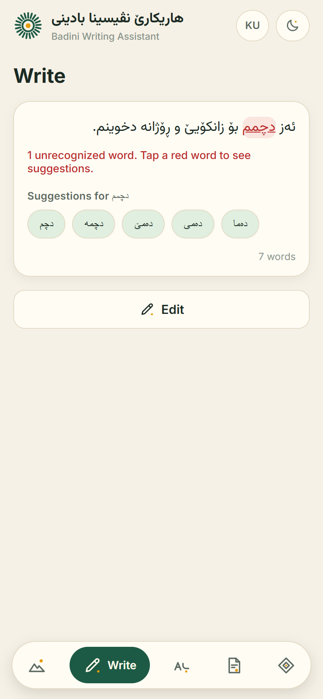 | 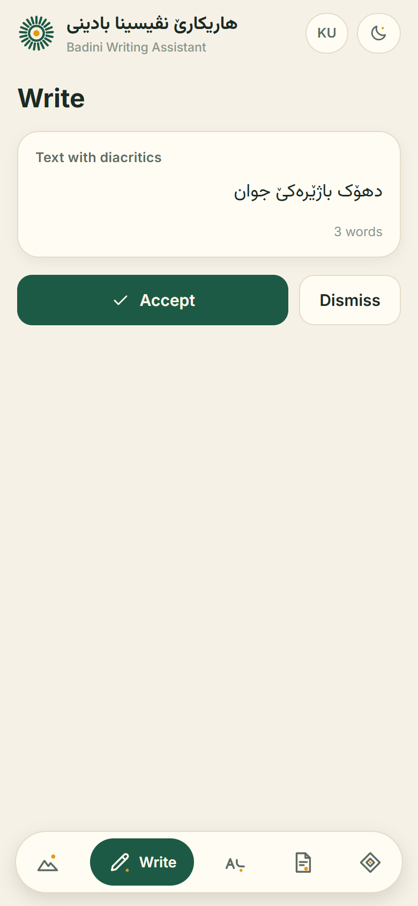 |

| Documents | A generated letter | More tools |
|---|---|---|
| 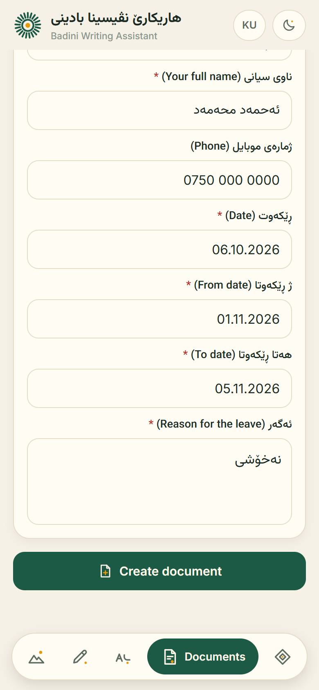 | 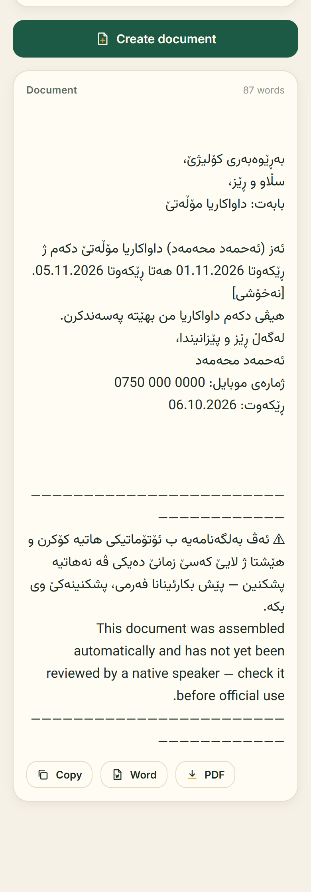 | 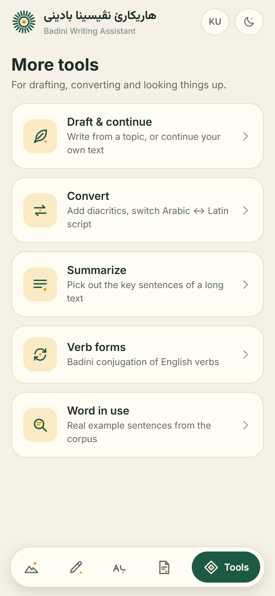 |

| Convert | Summarize | Verb forms |
|---|---|---|
| 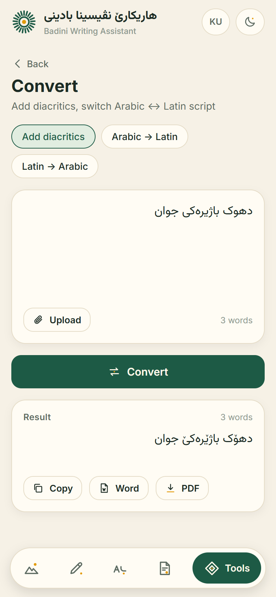 | 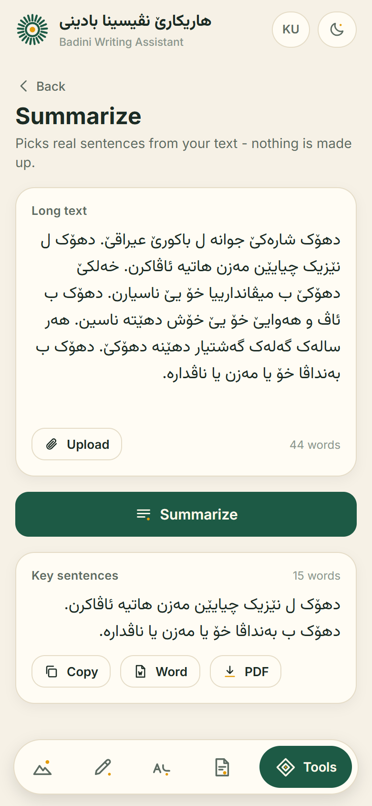 | 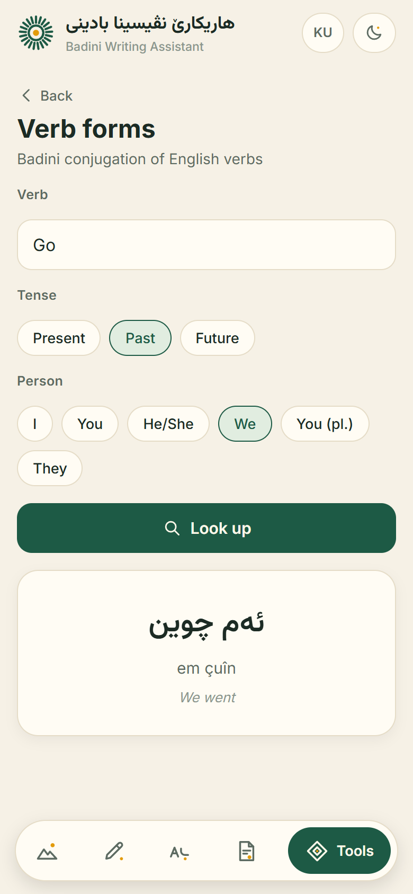 |

Dark theme with the Kurdish interface:

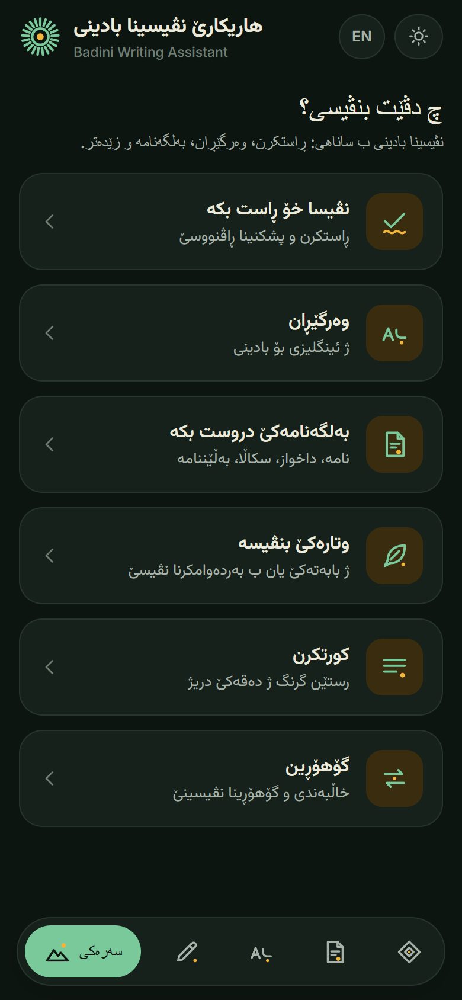

### Desktop

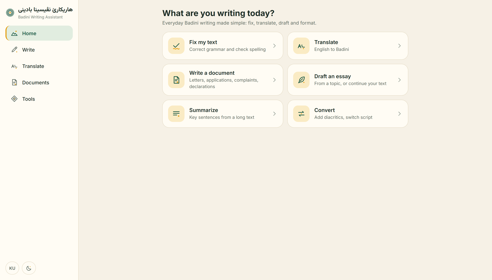

| Spelling | Documents |
|---|---|
| 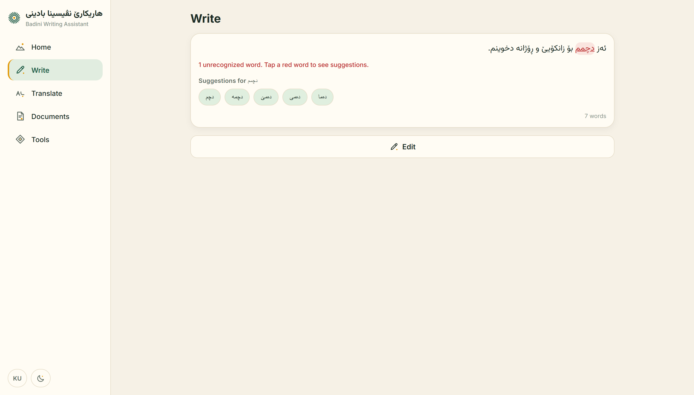 | 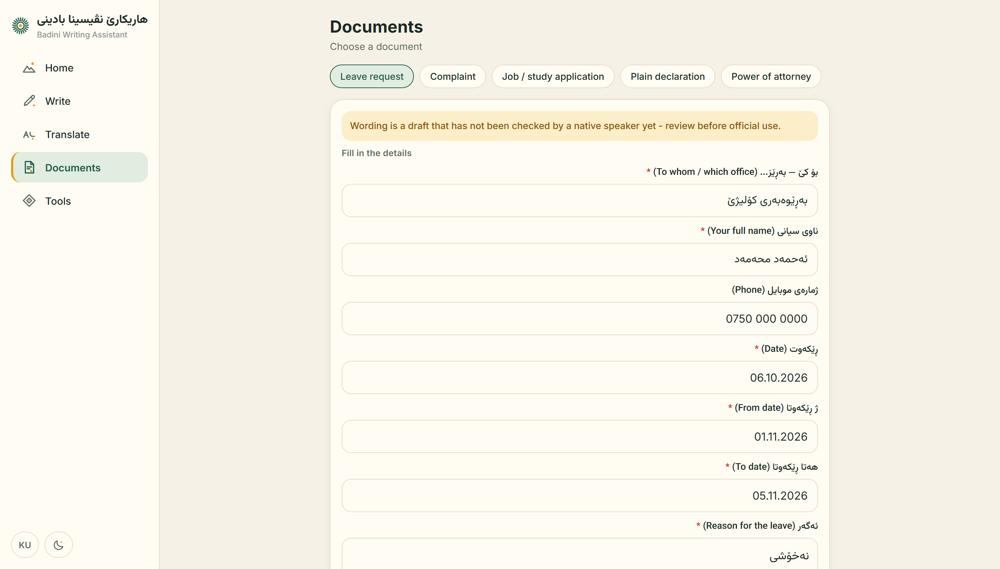 |

| Convert | Dark theme, Kurdish |
|---|---|
| 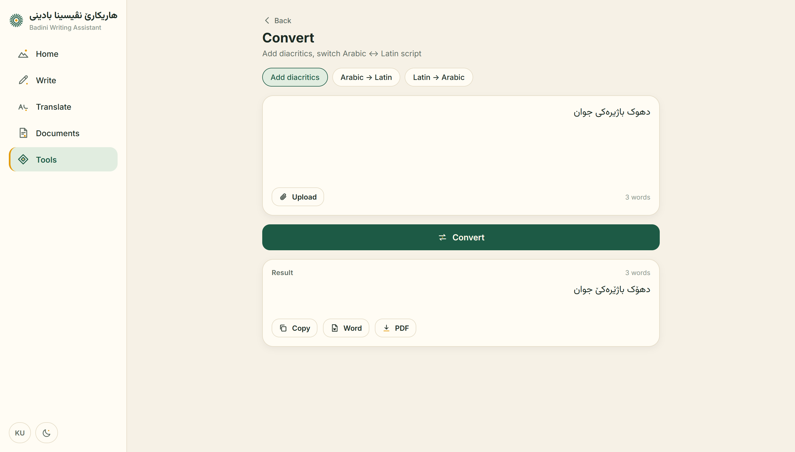 | 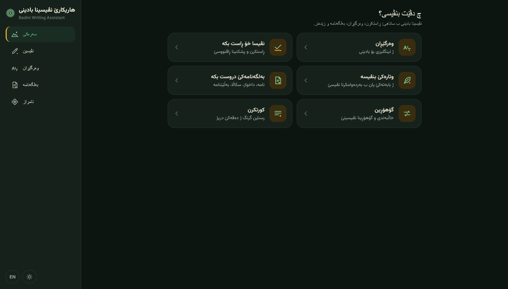 |

## Notes

- All names, phone numbers and dates in the screenshots are made-up examples.
- Document wording and the Kurdish interface are drafts that have not yet been reviewed by a
  native speaker. Review is planned before launch.

## Contact

Interested in testing it or following the launch? Open an issue on this repository, or
reach out at **[add your contact here]**.

---

&copy; 2026 Omar. All rights reserved. The screenshots and text in this repository may not
be reused without permission.
